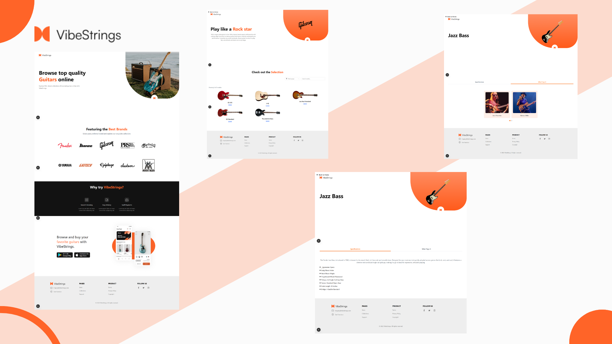

# VibeStrings

An online guitar shop that pulls its catalog from a live GraphQL API. You browse by brand, narrow models down with search and type filters, and open a detail view with full specifications and the musicians who play each guitar.



## Features

- **Brands.** Every guitar brand from the API on a landing grid, with each brand linking to its models.
- **Models.** All models for a brand, with:
  - live search by model name
  - filtering by guitar type, with the options taken from the brand's catalog
  - infinite scrolling built on `IntersectionObserver`
- **Guitar details.** A tabbed view:
  - **Specs.** Body wood, neck, pickups, bridge and other hardware.
  - **Musicians.** A carousel of artists who play the model.
- **Resilient data layer.** Apollo Client with an error link that reports GraphQL and network failures to the user as toasts.
- **Responsive design.** Built for phones up to wide desktop screens.

## Tech stack

| Layer     | Technology                                     |
| --------- | ---------------------------------------------- |
| Framework | Next.js 15 (App Router), React 19, TypeScript  |
| Data      | Apollo Client 3, GraphQL                       |
| Styling   | Tailwind CSS 4, shadcn/ui, Radix UI            |
| UI        | react-slick carousel, React Icons, Sonner      |

## Project structure

```
app/
  page.tsx                  Brand listing
  (pages)/brand/[brand.id]  Models for a brand: search, filter, infinite scroll
  (pages)/guitar/[guitar.id] Guitar details: specs and musicians tabs
components/                 Shared layout, states and shadcn/ui primitives
lib/apolloClient.ts         Apollo Client with error handling
providers/                  Apollo provider
```

## Getting started

### Prerequisites

- Node.js 18 or later

### Setup

```bash
git clone https://github.com/erdilatifi/VibeStrings.git
cd VibeStrings
npm install
npm run dev
```

Open http://localhost:3000.

The app uses a public demo GraphQL API by default. To point it somewhere else, copy `.env.example` to `.env.local` and set `NEXT_PUBLIC_GRAPHQL_ENDPOINT`.

### Scripts

| Command         | Description                   |
| --------------- | ----------------------------- |
| `npm run dev`   | Start the development server  |
| `npm run build` | Create a production build     |
| `npm start`     | Serve the production build    |
| `npm run lint`  | Run ESLint                    |

## License

Copyright (c) 2025 Erdi Latifi.

This project is source-available under the [PolyForm Noncommercial License 1.0.0](LICENSE). You may use, study and modify it for personal, educational and other noncommercial purposes. Commercial use is not permitted without written permission from the author.
